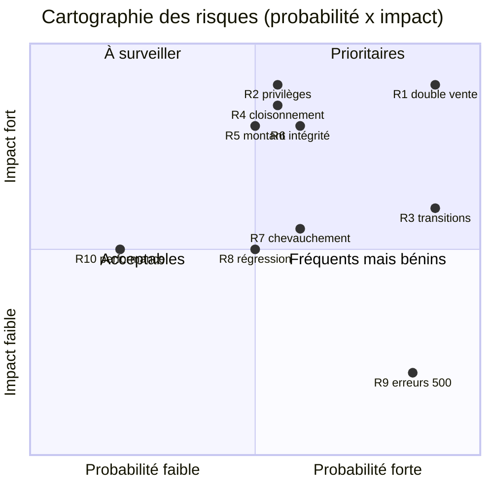

# 1. Fiche projet, système testé et cartographie des risques (semaine 1)

## 1.1 Système testé

**BusInTunisia** est une application web de réservation de billets de bus interurbains en Tunisie. Elle remplace l'application RéclaGest proposée dans l'énoncé, comme celui-ci l'autorise (« une application existante […] peut être utilisée, à condition de disposer de fonctionnalités et de règles métier testables »). La correspondance entre les deux référentiels est donnée au [chapitre 3](03-exigences-tracabilite.md#31-adaptation-du-référentiel-réclagest).

| Élément | Valeur |
|---|---|
| Frontal | React 18 + Vite 5 + Tailwind (`client/`) |
| API | Node.js 22 + Express 5, authentification JWT (`server/index.js`) |
| Logique métier isolée | `server/src/services/` (machine à états, tarification, validation des trajets, rôles) |
| Accès aux données | `server/src/repositories/` (réservations, bus) |
| Base de données | MariaDB 10.4 (XAMPP), schéma issu d'une application Symfony (`user`, `bus`, `seat`, `trip`, `booking`, `booking_seat`, `ticket`…) |
| Rôles | passager (`ROLE_USER`), opérateur (`ROLE_OPERATOR`), administrateur (`ROLE_ADMIN`) |

### Fonctions critiques

1. **Réserver un ou plusieurs sièges** sur un trajet (montant, disponibilité des sièges).
2. **Gérer le cycle de vie d'une réservation** : en attente, confirmée, annulée, terminée.
3. **Contrôler les accès** : un passager ne voit que ses réservations ; seules les personnes administratrices gèrent bus, trajets et validations.
4. **Planifier les trajets** : un bus ne peut pas être affecté à deux trajets qui se chevauchent.

## 1.2 Vocabulaire appliqué au projet

Ces notions sont illustrées par une anomalie réelle de la campagne (ANO-07, chevauchement de trajets non détecté).

| Notion | Définition | Illustration dans BusInTunisia |
|---|---|---|
| **Erreur** (humaine) | Action humaine qui produit un résultat incorrect | Le développeur a raisonné « deux trajets se chevauchent si l'un contient le départ ou l'arrivée de l'autre », en oubliant le cas où le nouveau trajet englobe l'ancien |
| **Défaut** (bogue) | Imperfection dans le code ou un document | La condition SQL de `POST /api/admin/trips` ne testait que les deux extrémités du nouvel intervalle |
| **Défaillance** | Écart observé entre le comportement et le comportement attendu | Le test API-27 crée un trajet 07:00–12:00 sur le bus 1 déjà planifié 08:00–10:30 : réponse `200 Trip created` au lieu de `400` |
| **Vérification** | « Construisons-nous le produit correctement ? » : conformité aux spécifications | Tests unitaires de `validateTrip`, tests API sur les codes HTTP |
| **Validation** | « Construisons-nous le bon produit ? » : adéquation au besoin réel | Parcours Playwright E2E-01 qui rejoue le besoin d'un passager, de la connexion au billet ; décision de livraison (chapitre 9) |

## 1.3 Périmètre de test

| Dans le périmètre | Hors périmètre (justification) |
|---|---|
| Authentification et inscription | Paiement (table `payment` présente, aucune route ne l'utilise) |
| Contrôle d'accès par rôle | Génération de QR code et impression PDF du billet (affichage seulement) |
| Recherche et détail des trajets, plan de sièges | Voyages de groupe (`/api/groups`, `/api/admin/groups`) : fonction secondaire, risque faible, testée seulement par l'absence d'erreur au chargement du tableau de bord |
| Réservation, annulation, billet, avis | Tableau de bord opérateur (lecture seule) |
| Administration : validation des réservations, trajets, bus | Compatibilité multi-navigateurs (Chromium seulement), responsive mobile |
| Persistance, intégrité, transactions | Charge au-delà de 20 utilisateurs simultanés, tests d'endurance |
| Performance élémentaire, sécurité de base (comptes, secret JWT) | Tests de pénétration (injection, XSS) au-delà de la revue de code |

## 1.4 Cartographie des risques qualité

Échelle : probabilité (P) et impact (I) de 1 (faible) à 3 (fort) ; criticité = P × I. Les risques de criticité ≥ 6 imposent une couverture par au moins deux niveaux de test.

| ID | Risque | P | I | Criticité | Exigences | Niveaux de test prévus |
|---|---|:-:|:-:|:-:|---|---|
| R1 | Un même siège est vendu deux fois (y compris par deux requêtes simultanées) | 3 | 3 | **9** | EX-06 | Intégration (concurrence), API, E2E |
| R2 | Un client accède aux fonctions d'administration (escalade de privilèges) | 2 | 3 | **6** | EX-03, EX-15 | API, intégration, E2E |
| R3 | Transition d'état illégale (annuler un voyage passé, confirmer une réservation annulée) | 3 | 2 | **6** | EX-07 | Unitaire (table complète), API |
| R4 | Un passager consulte ou annule la réservation d'un autre | 2 | 3 | **6** | EX-08 | Unitaire, API |
| R5 | Montant facturé erroné | 2 | 3 | **6** | EX-06 | Unitaire, intégration |
| R6 | Données incohérentes en base (sièges d'un autre bus, lignes orphelines après échec) | 2 | 3 | **6** | EX-12, EX-13 | Intégration, API |
| R7 | Un bus est planifié sur deux trajets simultanés | 2 | 2 | 4 | EX-09 | Unitaire, API, intégration (valeurs limites) |
| R8 | Régression introduite par les correctifs | 2 | 2 | 4 | toutes | Suite de régression en CI |
| R9 | Erreurs 500 non maîtrisées sur des entrées invalides | 3 | 1 | 3 | EX-02, EX-05, EX-09, EX-10 | API |
| R10 | Temps de réponse dégradés en période d'affluence | 1 | 2 | 2 | EX-14 | Performance |

