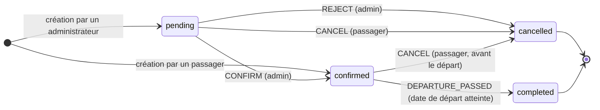

# 5. Transitions d'état, droits par rôle et tests exploratoires (semaine 5)

## 5.1 Diagramme d'états

Cycle de vie d'une réservation, implémenté dans `server/src/services/bookingStateMachine.js`.

`completed` n'est pas stocké en base : c'est l'état **effectif** d'une réservation `confirmed` dont la date de départ est passée ou atteinte (`effectiveStatus`). Le départ « exactement maintenant » est traité comme passé (valeur limite testée).

## 5.2 Table de transitions : 4 états × 4 événements = 16 couples

✅ transition autorisée (5) ; ❌ transition interdite (11), qui doit lever `InvalidTransitionError` (HTTP `409`) sans modifier la base.

| Depuis \ Événement | CONFIRM | REJECT | CANCEL | DEPARTURE_PASSED |
|---|---|---|---|---|
| `pending` | ✅ → `confirmed` · API-24 | ✅ → `cancelled` · UT | ✅ → `cancelled` · UT | ❌ |
| `confirmed` | ❌ | ❌ · API-34 | ✅ → `cancelled` · API-19 | ✅ → `completed` · UT |
| `cancelled` | ❌ · API-25 | ❌ | ❌ · API-20 | ❌ |
| `completed` | ❌ | ❌ | ❌ · API-21 | ❌ |

**Couverture** : les 16 couples sont vérifiés par `bookingStateMachine.test.js` (`test.each` sur le produit cartésien) ; 6 d'entre eux sont rejoués de bout en bout par l'API, dont 4 transitions interdites. Un état inconnu (`archived`) lève une erreur explicite.

### Scénarios associés

| Scénario | Chemin | Test |
|---|---|---|
| S1 Parcours nominal passager | [*] → `confirmed` → `cancelled` | E2E-01, API-11 → API-19 |
| S2 Validation administrative | [*] → `pending` → `confirmed` | API-24 |
| S3 Double annulation | `cancelled` → CANCEL | API-20 |
| S4 Annulation d'un voyage passé | `completed` → CANCEL | API-21, `bookingService.test.js` |
| S5 Réactivation interdite | `cancelled` → CONFIRM | API-25 |
| S6 Rejet après confirmation | `confirmed` → REJECT | API-34 |

## 5.3 Droits par rôle

| Action | Anonyme | Passager | Opérateur | Admin | Tests |
|---|:-:|:-:|:-:|:-:|---|
| Rechercher / consulter un trajet | ✅ | ✅ | ✅ | ✅ | API-08, 09 |
| Réserver | ❌ 401 | ✅ | ✅ | ✅ (`pending`) | API-11, 12, 13 ; E2E-02c |
| Voir / annuler **sa** réservation, son billet | ❌ 401 | ✅ | ✅ | ✅ | API-17, 19 |
| Voir / annuler la réservation **d'un autre** | ❌ 401 | ❌ 404 | ❌ 404 | ❌ 404 | API-18, 29 |
| Statistiques, bus, trajets, validations (`/api/admin/*`) | ❌ 401 | ❌ 403 | ❌ 403 | ✅ | API-22, 23 ; IT-25 |
| Trajets de ses bus (`/api/operator/trips`) | ❌ 401 | liste vide | ✅ | liste vide | non testé (hors périmètre) |

Remarque : le contrôle `requireAdmin` relit le rôle **en base** à chaque requête ; un rôle retiré à un utilisateur prend donc effet immédiatement, même si son jeton est encore valide.

## 5.4 Tests exploratoires

Trois chartes d'exploration (mission, zone, durée prévue) ont guidé l'exploration, menée par lecture critique du code, requêtes manuelles sur l'API et consultation de la base de développement. Les défauts trouvés ont ensuite été **transformés en tests automatisés** avant d'être corrigés, pour prouver la défaillance puis le correctif.

### Session 1 — « Explorer la réservation avec des sièges et des bus variés » (durée prévue : 45 min)

| Observation | Suite donnée |
|---|---|
| Sur le trajet 3 (bus 2, sièges id 41–80), l'IHM envoie les numéros 1–40, qui sont enregistrés tels quels comme `seat_id`, donc des sièges **du bus 1** | **ANO-09** ; vérifié aussi dans la base de développement : des réservations des bus 2, 11 et 14 pointent vers les sièges 1, 2, 5 et 29 du bus 1. Test API-90 |
| Le siège 3 (réservation `pending`) apparaît libre sur le plan et peut être revendu | **ANO-14** ; tests IT-24, E2E-01 étape 4 |
| Aucune limite au nombre de sièges côté serveur (l'IHM limite à 9) | **ANO-11** ; API-30, API-31 |
| Deux clients qui réservent le même siège sont tous deux acceptés | **ANO-03** ; API-15, IT-21 |

### Session 2 — « Explorer les droits, la session et les comptes » (durée prévue : 40 min)

| Observation | Suite donnée |
|---|---|
| La page de connexion publie `admin@bus.tn / admin123`, et ce compte ouvre l'administration complète | **ANO-12** (critique) ; API-32, E2E-02b |
| Si `JWT_SECRET` est absent, le serveur signe les jetons avec `'secret'` : n'importe qui peut forger un jeton administrateur | **ANO-15** |
| Un passager qui « annule » la réservation d'un autre reçoit `200 Cancelled` (rien n'est modifié, mais le message est faux) | **ANO-06** ; API-29 |
| Le tableau de bord affiche le bouton « Cancel » sur un voyage déjà passé ; depuis le correctif ANO-05, le serveur répond `409` et l'IHM affiche un message générique « Failed to cancel booking » | **ANO-17** (constaté par revue de `UserDashboard.jsx`, non automatisé) |

### Session 3 — « Explorer l'administration : bus et trajets » (durée prévue : 35 min)

| Observation | Suite donnée |
|---|---|
| Un trajet 07:00–12:00 est accepté sur un bus déjà planifié 08:00–10:30 | **ANO-07** ; API-27, IT-28, IT-29 |
| Un trajet sans prix provoque une erreur 500 ; des dates illisibles passent la validation | **ANO-08** ; API-26 |
| Le formulaire de bus propose l'opérateur « None », mais la colonne est `NOT NULL` : erreur 500 | **ANO-16** ; IT-18, IT-26 |
| Une réservation confirmée peut être « rejetée » par l'administrateur ; une annulée peut être reconfirmée | **ANO-05** ; API-25, API-34 |

Les fiches détaillées sont dans le [registre des anomalies](06-registre-anomalies.md).
