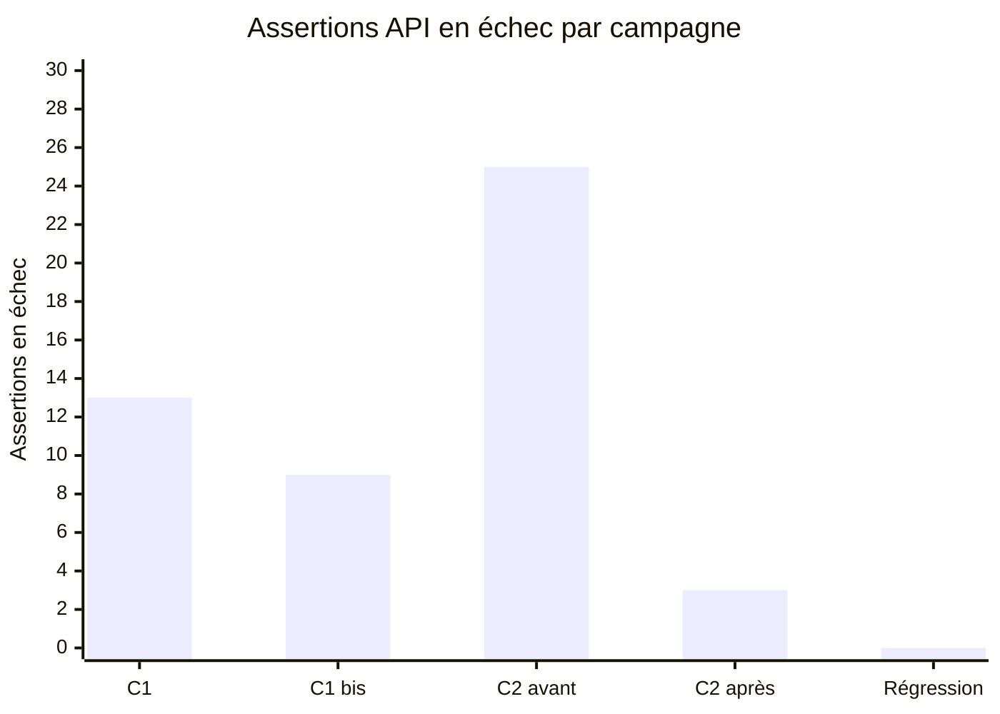
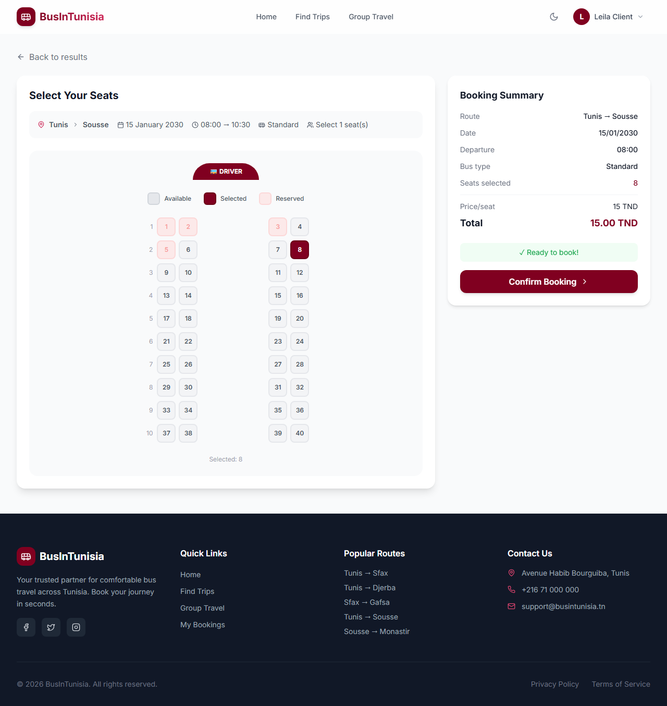
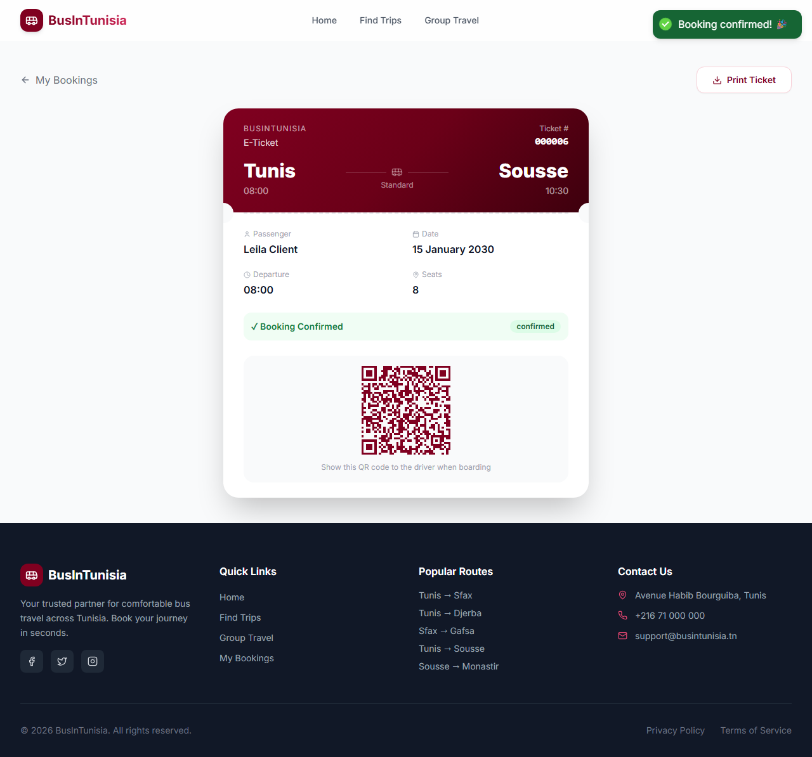

# 7. Scripts automatisés, instructions et résultats d'exécution

## 7.1 Instructions d'exécution

**Prérequis** : Node.js 22, MariaDB 10.4 ou plus récent (XAMPP convient), fichier `server/.env` créé à partir de `server/.env.example` (au minimum `DB_USER`, `DB_PASSWORD`, `JWT_SECRET`). La base `bus_in_tunisia_test` est créée automatiquement.

```bash
cd server && npm install
cd ../client && npm install && npx playwright install chromium
```

| Commande (depuis `server/`) | Ce qu'elle fait | Durée |
|---|---|---|
| `npm test` | Tests unitaires | ~ 5 s |
| `npm run test:integration` | Tests d'intégration (MariaDB requis) | ~ 10 s |
| `npm run test:coverage` | Unitaires + intégration, rapport de couverture, **échoue si un seuil n'est pas atteint** | ~ 15 s |
| `npm run test:api` | Collection Postman complète (y compris défauts connus) via Newman | ~ 10 s |
| `npm run test:api:regression` | Collection sans le dossier « 9. Défauts connus » | ~ 10 s |
| `npm run test:regression` | **Suite de régression** : couverture + API régression | ~ 30 s |
| `npm run test:perf` | Test de charge (3 × 20 s) | ~ 70 s |

| Commande (depuis `client/`) | Ce qu'elle fait |
|---|---|
| `npm run test:e2e` | Réinitialise la base de test, démarre l'API (port 5056) et le build du client (port 5174), exécute les scénarios Playwright |
| `npm run test:e2e:report` | Ouvre le rapport HTML Playwright (captures, vidéos et traces en cas d'échec) |

Pour la collection Postman dans l'application Postman : importer `server/tests/api/BusInTunisia.postman_collection.json`, lancer `npm run db:reset`, démarrer l'API sur la base de test (`PORT=5055 DB_NAME=bus_in_tunisia_test node index.js`), puis exécuter la collection avec le *Collection Runner*.

## 7.2 Résultats de la campagne finale (19/11/2026)

Environnement : Windows 11, Node.js 22.16, MariaDB 10.4.32 (XAMPP), Chromium (Playwright 1.x), 8 cœurs. Sorties brutes dans [`docs/preuves/`](preuves/).

| Niveau | Exécutés | Réussis | Échecs | Preuve |
|---|---:|---:|---:|---|
| Unitaires (Jest, 5 fichiers) | 68 | 68 | 0 | `preuves/regression-serveur.txt` |
| Intégration (Jest + MariaDB, 3 fichiers) | 29 | 29 | 0 | idem |
| API — suite de régression (34 requêtes) | 66 assertions | 66 | 0 | `newman-report-regression.json` |
| API — collection complète (36 requêtes) | 69 assertions | 66 | 3 | `newman-report-complet.json`, `preuves/api-collection-complete.txt` |
| IHM (Playwright) | 4 scénarios | 4 | 0 | `preuves/e2e-playwright.txt`, captures |
| IHM — stabilité (`--repeat-each=3`) | 12 | 12 | 0 | — |
| Performance (autocannon) | 3 scénarios | 3 conformes | 0 | `tests/perf/reports/perf-2026-11-19.json`, `preuves/perf-charge.txt` |

Les 3 assertions en échec de la collection complète appartiennent aux tests API-90 (ANO-09) et API-91 (ANO-10), qui documentent des anomalies **ouvertes** : ces échecs sont attendus.

## 7.3 Évolution entre campagnes (tests API)

| Campagne | Code testé | Requêtes | Assertions | Échecs | Rapport |
|---|---|---:|---:|---:|---|
| 1 — semaine 8 | Version initiale | 25 | 49 | **13** | `newman-report-avant-correctifs.*` |
| 1 bis | Après correctifs ANO-01, ANO-02 | 25 | 49 | 9 | `newman-report-intermediaire.*` |
| 2 — semaine 10, avant correctifs | Collection enrichie (11 nouveaux tests) | 36 | 69 | **25** | `newman-report-campagne2-avant-correctifs.*` |
| 2 — après correctifs | Correctifs ANO-03 à ANO-16 | 36 | 69 | **3** | `newman-report-campagne2-apres-correctifs.*` |
| Régression finale | Version livrable, hors défauts connus | 34 | 66 | **0** | `newman-report-regression.*` |



La hausse entre C1 bis et C2 n'est pas une régression : elle vient des 11 tests ajoutés après les sessions exploratoires, qui ont révélé de nouveaux défauts. Ils ont été écrits et exécutés **avant** les correctifs, pour prouver chaque défaillance.

## 7.4 Parcours d'interface automatisé (E2E-01)

Scénario critique rejoué dans Chromium, sur le build de production :

1. Connexion de la passagère `client2.test@bus.tn` → redirection vers `/dashboard`.
2. Recherche Tunis → Sousse, 15/01/2030, 1 passager.
3. Choix du trajet 1 → page « Select Your Seats ».
4. Les sièges 1, 2, 3 (en attente) et 5 sont désactivés.
5. Sélection du siège 8 → « ✓ Ready to book! » → confirmation.
6. Billet : Tunis, Sousse, siège 8, `confirmed`, n° de billet sur 6 chiffres, nom de la passagère, aucun « undefined ».
7. Tableau de bord : la réservation apparaît ; annulation → « Booking cancelled », statut `cancelled`.
8. Retour sur le plan du trajet 1 : le siège 8 est de nouveau disponible.

| Siège sélectionné (étape 5) | Billet obtenu (étape 6) |
|---|---|
|  |  |

Les scénarios E2E-02 vérifient le refus d'identifiants invalides, l'absence et le refus du compte démo administrateur, et la redirection d'un visiteur anonyme vers `/login`.

**Incident d'automatisation.** Au premier lancement, E2E-01 a échoué sur une page blanche. Cause : le serveur de développement Vite optimise ses dépendances au premier chargement d'une page et recharge alors le navigateur en plein test. Ce n'était pas un défaut de l'application. Le scénario s'exécute désormais sur le build de production (`vite build` + `vite preview`), plus proche de la mise en service ; 12 exécutions consécutives ont réussi.

## 7.5 Test non fonctionnel : performance

| Élément | Valeur |
|---|---|
| Outil | autocannon 8 (`server/tests/perf/loadTest.js`) |
| Protocole | Base de test réinitialisée ; API seule sur le port 5057 ; préchauffage 3 s ; puis, pour chaque scénario, **20 connexions simultanées pendant 20 s** |
| Critères (EX-14) | 0 erreur, 0 réponse non-2xx, p97,5 < 500 ms, p99 < 1 000 ms |

| Scénario | Requêtes | Débit moyen | p50 | p90 | p97,5 | p99 | Max | Erreurs | Verdict |
|---|---:|---:|---:|---:|---:|---:|---:|---:|---|
| PERF-01 Recherche de trajets | 14 044 | 702 req/s | 28 ms | 35 ms | 40 ms | 45 ms | 71 ms | 0 | Conforme |
| PERF-02 Détail trajet + sièges | 11 892 | 595 req/s | 33 ms | 43 ms | 48 ms | 51 ms | 64 ms | 0 | Conforme |
| PERF-03 Mes réservations (authentifié) | 2 844 | 142 req/s | 137 ms | 160 ms | 209 ms | 232 ms | 272 ms | 0 | Conforme |

*autocannon fournit les centiles p97,5 et p99, mais pas p95 : les seuils sont donc exprimés sur ces centiles.*

**Interprétation.** Les trois scénarios respectent les seuils avec une marge importante (p99 maximal 232 ms pour 1 000 ms autorisées). PERF-03 est environ cinq fois plus lent que les scénarios publics. Une mesure ciblée l'explique :

- la vérification du jeton JWT coûte environ **1,8 ms de calcul par requête** sur ce poste ; comme Node.js traite les requêtes sur un seul fil d'exécution, ce coût s'accumule sous charge ;
- la requête « mes réservations » enchaîne 6 jointures et une sous-requête dépendante ; `EXPLAIN` montre une table temporaire et un tri (`Using temporary; Using filesort`).

**Limites.** Jeu de données minimal (5 réservations, 3 trajets) : le coût des requêtes sur un volume réel n'est pas mesuré ; client de charge et serveur sur la même machine ; une seule exécution par scénario. **Recommandation** : rejouer le test avec un jeu de données volumineux et ajouter un index `booking(passenger_id, booking_date)` avant une montée en charge.
