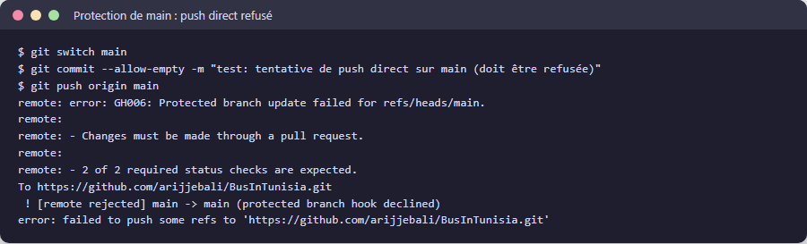
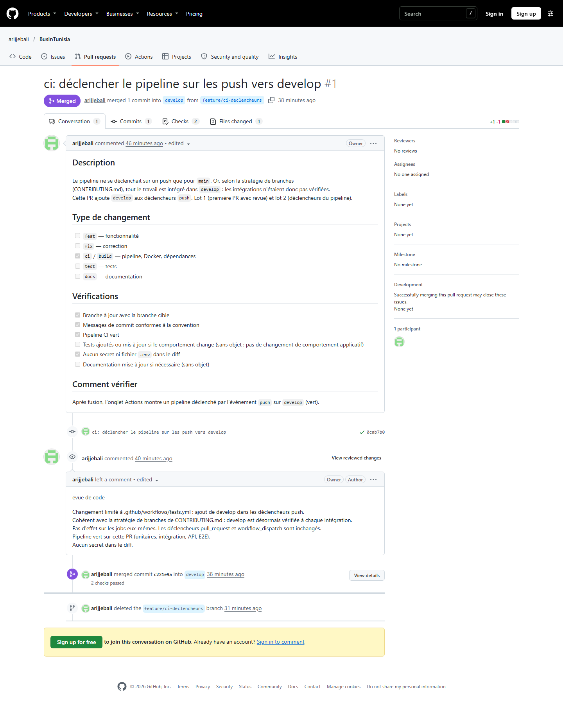
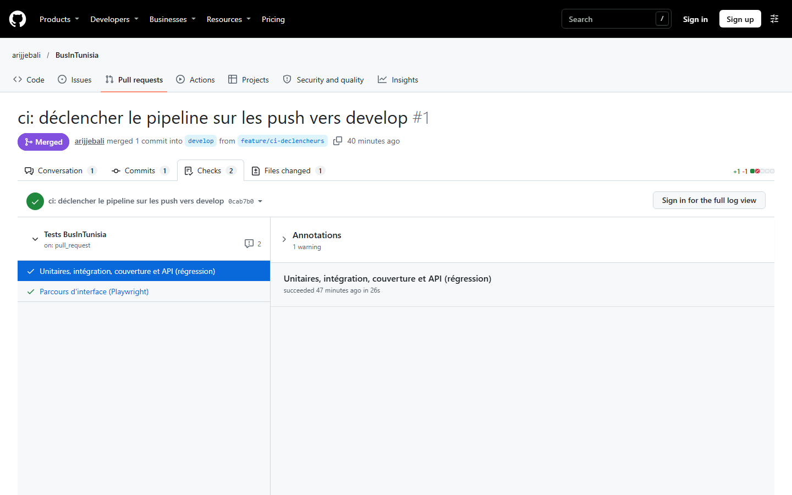
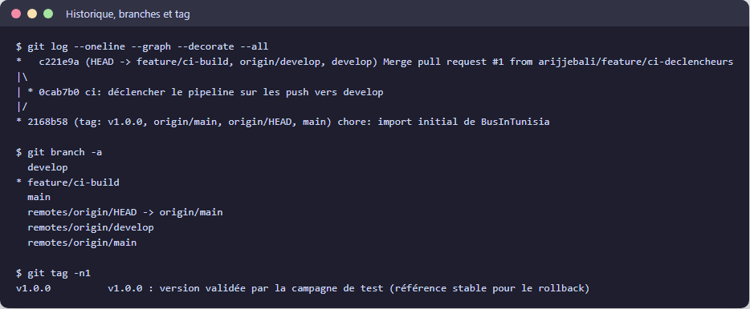
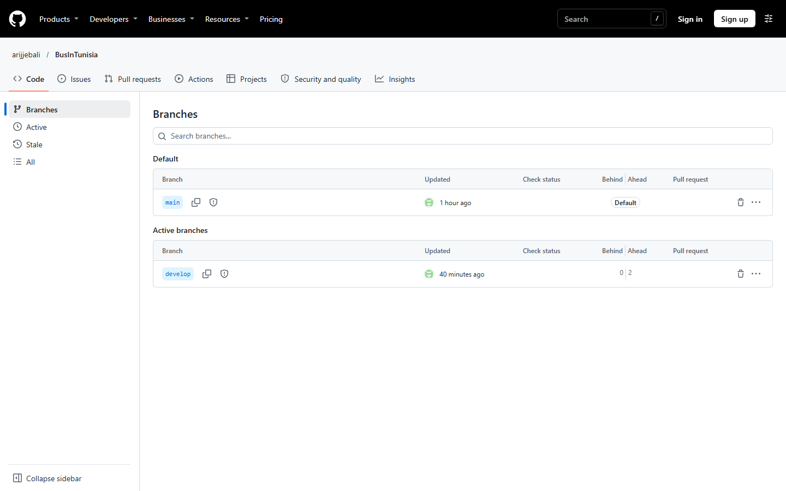

# 1. Organisation du dépôt et collaboration Git (lot 1)

## 1.1 Dépôt

| Élément | Valeur |
|---|---|
| Dépôt distant | https://github.com/arijjebali/BusInTunisia (public, aucun secret versionné) |
| Plateforme CI/CD | GitHub Actions |
| Version de référence | tag `v1.0.0` : version validée par la campagne de test (sert de version stable pour le rollback) |

Structure du dépôt et règles de contribution : [CONTRIBUTING.md](../../CONTRIBUTING.md).

## 1.2 Stratégie de branches

Git Flow simplifié : `main` (stable) ← `develop` (intégration) ← `feature/*`, `fix/*`, `hotfix/*`.
Chaque étape du projet DevOps est développée dans sa propre branche `feature/…` puis intégrée par pull request.

## 1.3 Protection des branches

Règle « classic branch protection » appliquée à `main` et `develop` :

| Règle | `main` | `develop` |
|---|---|---|
| Pull request obligatoire (pas de push direct) | ✅ | ✅ |
| Checks obligatoires : `Unitaires, intégration, couverture et API (régression)`, `Parcours d'interface (Playwright)` | ✅ | ✅ |
| Branche à jour avec la cible avant fusion | ✅ | — |
| Aucun contournement, même administrateur | ✅ | ✅ |
| Force push et suppression interdits | ✅ | ✅ |
| Approbations requises | 0 | 0 |

**Approbations à 0 :** le projet est réalisé seul et GitHub interdit d'approuver sa propre pull request ;
une approbation obligatoire bloquerait toute fusion. La revue est donc une relecture commentée
(*Review changes → Comment*) déposée sur chaque PR. En binôme, la règle passerait à 1 approbation.

**Vérification** : une tentative de push direct sur `main` est refusée par GitHub, pour les deux motifs attendus
(PR obligatoire et checks obligatoires).

## 1.4 Première pull request avec revue

PR n° 1 — `ci: déclencher le pipeline sur les push vers develop` (`feature/ci-declencheurs` → `develop`) :
un vrai défaut corrigé (le pipeline n'était déclenché que sur `main`), description selon le modèle,
pipeline vert sur la PR (2/2), revue commentée, fusion par commit de fusion, branche supprimée.

## 1.5 Historique

