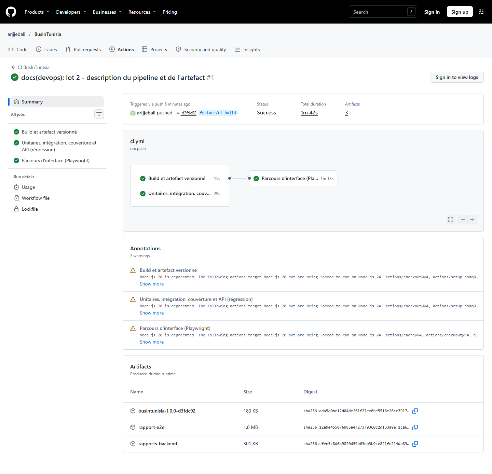
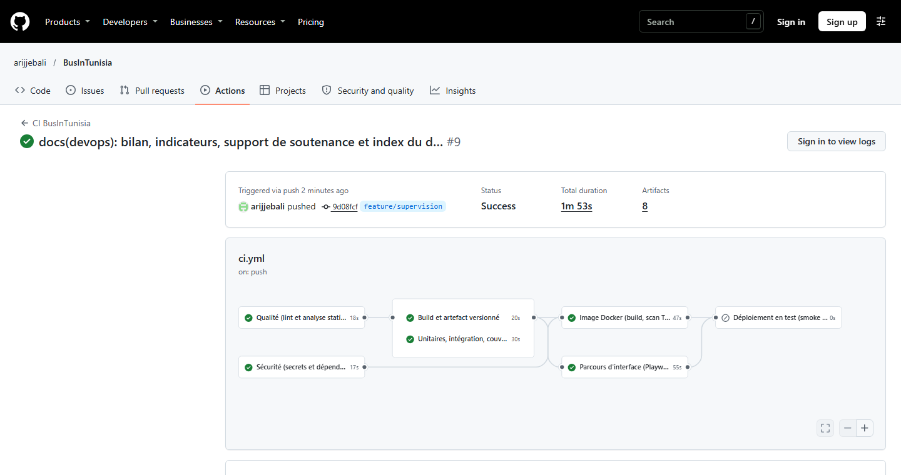

# 2. Pipeline d'intégration continue et construction (lot 2)

Fichier : [`.github/workflows/ci.yml`](../../.github/workflows/ci.yml) (pipeline as code, GitHub Actions).

## 2.1 Déclencheurs

| Événement | Branches | Raison |
|---|---|---|
| `push` | `main`, `develop`, `feature/**`, `fix/**`, `hotfix/**` | Toute branche est vérifiée dès son push, avant même la PR |
| `push` de tag | `v*` | Construction d'une version publiée (ex. `v1.1.0`) |
| `pull_request` | toutes | Quality gate : la protection de branche exige un pipeline vert avant fusion |
| `workflow_dispatch` | manuel | Relance à la demande, avec option « test de performance » |

`concurrency` : un nouveau push sur la même référence annule le pipeline précédent, devenu inutile.
`permissions: contents: read` : le jeton du pipeline n'a que le droit de lecture (moindre privilège).

## 2.2 Jobs et dépendances

```
            ┌──► build ─────────────┐
quality ────┤                       ├──► e2e
            └──► backend (tests) ───┘
```

`quality` (lint, ~20 s) s'exécute d'abord : un échec arrête tout le pipeline (échec rapide).
`build` et `backend` s'exécutent ensuite en parallèle ; `e2e`, le plus long, ne démarre que si les deux ont réussi.

| Job | Rôle | Entrées | Sorties | Échec si… |
|---|---|---|---|---|
| **quality** — *Qualité (lint et analyse statique)* | ESLint du serveur et du client | Code source | Artefact `rapports-qualite` (JSON) | Une erreur ESLint ou plus de 5 avertissements (détail : [03-qualite-tests.md](03-qualite-tests.md)) |
| **build** — *Build et artefact versionné* | Calcule la version, construit le client React, prépare le serveur sans dépendances de dev, assemble l'artefact | Code source, `package-lock.json` | Artefact `busintunisia-<version>-<sha>` (archive `.tar.gz`) ; sortie `version` | `npm ci` ou `vite build` échoue, ou l'archive est absente (`if-no-files-found: error`) |
| **backend** — *Unitaires, intégration, couverture et API (régression)* | Tests Jest unitaires et d'intégration avec seuils de couverture, puis collection API Newman | Code serveur, service MariaDB jetable | Artefact `rapports-backend` (couverture HTML/LCOV, rapports Newman) | Un test échoue ou un seuil de couverture n'est pas atteint |
| **e2e** — *Parcours d'interface (Playwright)* | Parcours utilisateur complets dans Chromium | Client + serveur, MariaDB jetable | Artefact `rapport-e2e` (rapport HTML, JUnit, captures) | Un scénario échoue |

## 2.3 Installation reproductible et cache

- `npm ci` (et non `npm install`) : installe **exactement** les versions de `package-lock.json` et échoue si le
  fichier de verrouillage ne correspond pas à `package.json`.
- Cache npm (`actions/setup-node`, `cache: npm`) indexé sur les `package-lock.json` du client et du serveur.
- Cache des navigateurs Playwright (`actions/cache`) indexé sur la version de Playwright : ~150 Mo qui ne sont
  plus téléchargés à chaque exécution ; seules les dépendances système sont réinstallées.

## 2.4 Artefact versionné

| Propriété | Valeur |
|---|---|
| Nom | `busintunisia-<version package.json>-<sha court>`, ex. `busintunisia-1.0.0-3f2a9c1` |
| Contenu | `client/dist/` (build de production), `server/` (code, `package.json`, `package-lock.json`, `.env.example`), fichier `VERSION` |
| Fichier `VERSION` | version, commit complet, branche ou tag, date de construction, lien vers le pipeline |
| Récupération | Onglet *Actions* → exécution → section *Artifacts* ; conservation 30 jours |

Le sha du commit dans le nom garantit qu'un artefact est toujours rattaché au code exact qui l'a produit.
L'image Docker (lot 4) reprend la même règle de versionnement.

## 2.5 Preuves

Premier pipeline structuré (lot 2) puis pipeline complet final (7 jobs ; le déploiement est ignoré hors de `develop`) :




Le pipeline complet ajoute les jobs `security`, `docker` et `deploy-test` : voir [06](06-securite.md) et [07](07-deploiement.md).
