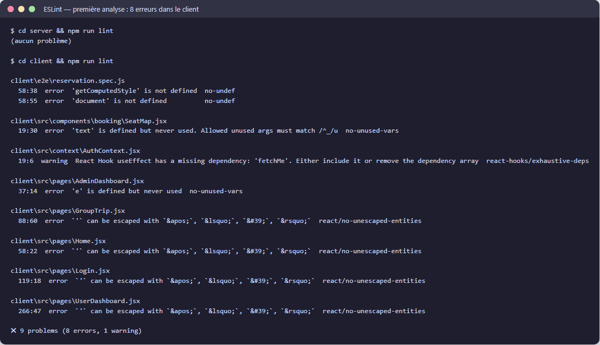
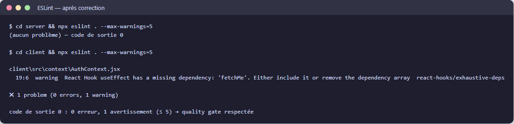
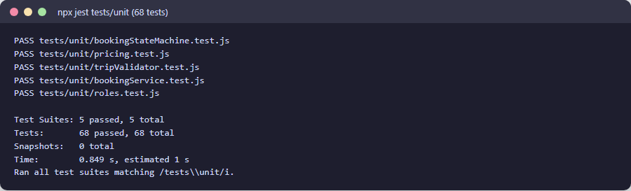

# 3. Qualité logicielle et tests automatisés (lot 3)

## 3.1 Vue d'ensemble

| Contrôle | Outil | Où | Bloquant ? |
|---|---|---|---|
| Linting / analyse statique | ESLint 9 (`server/eslint.config.js`, `client/eslint.config.js`) | job **Qualité** | Oui : toute erreur, ou plus de 5 avertissements |
| Analyse statique de sécurité (SAST) | CodeQL, requêtes `security-and-quality` | workflow `codeql.yml` | Alertes dans *Security → Code scanning* |
| Tests unitaires | Jest — 68 tests (`server/tests/unit/`) | job **backend** | Oui |
| Tests d'intégration | Jest + supertest + MariaDB — 29 tests (`server/tests/integration/`) | job **backend** | Oui |
| Tests API | Newman — collection Postman, suite de régression | job **backend** | Oui |
| Couverture | Jest (`coverageThreshold`) | job **backend** | Oui : seuils par dossier |
| Parcours d'interface | Playwright — 4 scénarios | job **e2e** | Oui |

Les tests proviennent du mini-projet « Test et validation » (voir `docs/04` à `docs/08`) ; ce lot les intègre
à la chaîne et ajoute le linting, l'analyse statique, les rapports et les quality gates.

## 3.2 Base de test distincte

Les tests d'intégration, API et E2E utilisent une base **`bus_in_tunisia_test`**, recréée (schéma + jeu de données)
avant chaque campagne par `server/tests/db/resetTestDb.js`. Garde-fou : le script refuse toute base dont le nom
ne se termine pas par `_test`. En CI, la base vit dans un conteneur MariaDB jetable (service du job), détruit en
fin de job.

## 3.3 Règles ESLint retenues

| Famille | Règles | Niveau |
|---|---|---|
| Recommandées ESLint | `@eslint/js` recommended (variables non définies, code inatteignable…) | erreur |
| Bugs probables | `eqeqeq`, `no-var`, `no-unused-vars`, `no-implicit-globals` | erreur |
| Sécurité | `no-eval`, `no-implied-eval`, `no-new-func`, `react/no-danger` (XSS) | erreur |
| React | `react` recommended, `react-hooks/rules-of-hooks` | erreur |
| Maintenabilité | `prefer-const`, `complexity` > 15, `react-hooks/exhaustive-deps` | avertissement |
| Tests | `eslint-plugin-jest` recommended | erreur |

## 3.4 Première analyse et corrections

La première exécution d'ESLint a trouvé **0 problème dans le serveur** et **8 erreurs + 1 avertissement dans le client** :

| Problème | Fichier | Correction |
|---|---|---|
| `'text'` déstructuré mais jamais utilisé | `SeatMap.jsx` | Variable retirée |
| `'e'` capturé mais jamais utilisé | `AdminDashboard.jsx` | `catch {` (liaison optionnelle ES2019) |
| Apostrophe non échappée dans le JSX (×4) | `GroupTrip`, `Home`, `Login`, `UserDashboard` | `&apos;` |
| `getComputedStyle`, `document` non définis | `e2e/reservation.spec.js` | Faux positif : ce code s'exécute **dans la page** (`waitForFunction`) ; globals navigateur ajoutés pour les fichiers E2E |
| Dépendance `fetchMe` absente du `useEffect` (avertissement) | `AuthContext.jsx` | **Non corrigé, justifié** : l'ajouter relancerait la requête `/auth/me` à chaque rendu ; la corriger proprement demande un `useCallback` et un nouveau test du parcours de connexion. Suivi comme dette technique |

## 3.5 Quality gates

1. **Lint** : le job *Qualité* échoue sur une erreur ESLint ou plus de 5 avertissements (`--max-warnings=5`) ;
   *build* et *backend* en dépendent (`needs: quality`) et ne s'exécutent donc pas.
2. **Tests** : un test en échec fait échouer *backend* ou *e2e*.
3. **Couverture** : `jest.coverageThreshold` (`server/package.json`) — global ≥ 35 % des lignes,
   `src/services/**` ≥ 90 % et `src/repositories/**` ≥ 90 % des lignes. En dessous, le job échoue.
4. **Fusion** : la protection des branches exige les jobs *backend* et *e2e* verts pour fusionner une PR.

## 3.6 Rapports produits et archivés

| Rapport | Format | Artefact du pipeline |
|---|---|---|
| ESLint serveur et client | JSON | `rapports-qualite` |
| Tests Jest | JUnit XML (`jest-junit`) | `rapports-backend` |
| Couverture | HTML, LCOV, JSON | `rapports-backend` |
| Tests API | Newman JSON + JUnit | `rapports-backend` |
| Parcours E2E | HTML Playwright, JUnit, captures | `rapport-e2e` |
| Résumé tests + couverture | Markdown | page du pipeline (onglet *Summary*) |
| CodeQL | SARIF | onglet *Security → Code scanning* |

Les captures du pipeline (job *Qualité*, résumé de couverture) sont dans [preuves/](preuves/) (`lot3-*`).

## 3.7 Avertissement de plateforme traité

Le premier pipeline affichait l'annotation *« Node.js 20 is deprecated »* pour les actions `checkout`, `setup-node`,
`upload-artifact` et `cache` en v4. Elles ont été mises à jour vers leurs versions majeures actuelles
(`checkout@v7`, `setup-node@v7`, `upload-artifact@v7`, `cache@v6`).
