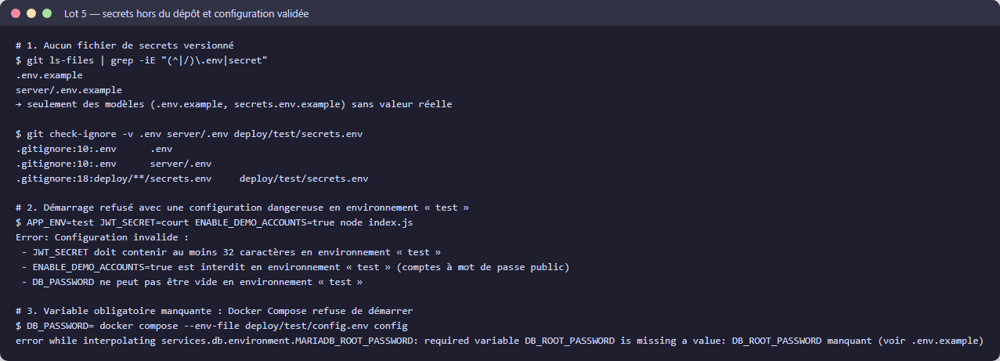

# 5. Configurations, environnements et secrets (lot 5, partie 1)

## 5.1 Environnements

| | **Développement** | **CI** (intégration continue) | **Test** (déploiement) |
|---|---|---|---|
| Où | Poste du développeur | Runner GitHub `ubuntu-latest`, jetable | Poste de démonstration, via le runner auto-hébergé (lot 6) |
| Lancement | `docker compose up -d --build` ou `npm start` + `npm run dev` | Automatique à chaque push / PR | Automatique après fusion dans `develop`, avec approbation manuelle |
| Image | Construite localement (`busintunisia:local`) | Construite par le job `docker` | **Tirée de ghcr.io** (`sha-<commit>`) : jamais reconstruite |
| Projet Compose | `busintunisia-dev` | — (services de job) | `busintunisia-test` (réseaux et volumes distincts) |
| URL | http://localhost:8000 (Compose) ou :5173 (Vite) | — | http://localhost:8080 |
| Base | `bus_in_tunisia` (volume `busintunisia-dev_db-data`) | `bus_in_tunisia_test`, conteneur détruit en fin de job | `bus_in_tunisia` (volume `busintunisia-test_db-data`) |
| `APP_ENV` | `development` | non défini (= development) | `test` → règles strictes |
| Source de la configuration | `.env` (copie de `.env.example`) | `env:` de `ci.yml` | `deploy/test/config.env` (versionné) |
| Source des secrets | `.env` local, ignoré par Git | Générés à l'exécution | **Secrets de l'environnement GitHub « test »** |

## 5.2 Matrice des variables

| Variable | Rôle | Sensible | Développement | CI | Test |
|---|---|:-:|---|---|---|
| `APP_ENV` | Niveau d'exigence de la configuration | non | `development` | — | `test` |
| `APP_PORT` | Port publié sur l'hôte | non | `8000` | — | `8080` |
| `APP_IMAGE` / `APP_TAG` | Image applicative déployée | non | `busintunisia` / `local` | — | `ghcr.io/arijjebali/busintunisia` / `sha-<commit>` (fourni par le pipeline) |
| `DB_IMAGE` | Image MariaDB | non | `mariadb:10.11` (surchargeable) | `mariadb:10.11` | `mariadb:10.11` |
| `DB_HOST` / `DB_PORT` | Adresse de la base | non | `db` / `3306` | `127.0.0.1` / `3306` | `db` / `3306` |
| `DB_NAME` | Nom de la base | non | `bus_in_tunisia` | `bus_in_tunisia_test` | `bus_in_tunisia` |
| `DB_USER` | Compte applicatif | non | `busintunisia` | `root` (base jetable) | `busintunisia` |
| `DB_PASSWORD` | Mot de passe du compte applicatif | **oui** | `.env` local | `root` *(voir § 5.4)* | secret `TEST_DB_PASSWORD` |
| `DB_ROOT_PASSWORD` | Administration de MariaDB | **oui** | `.env` local | `root` *(voir § 5.4)* | secret `TEST_DB_ROOT_PASSWORD` |
| `JWT_SECRET` | Signature des jetons de connexion | **oui** | `.env` local | **aléatoire à chaque exécution**, masqué | secret `TEST_JWT_SECRET` (≥ 32 caractères) |
| `ENABLE_DEMO_ACCOUNTS` | Comptes de démonstration à mot de passe public | non | `false` | — | `false` (**`true` refusé**) |
| `LOG_LEVEL` | Verbosité des journaux | non | `debug` | — | `info` |
| `GITHUB_TOKEN` | Publication dans ghcr.io | **oui** | — | jeton éphémère fourni par GitHub | — |

## 5.3 Règles de gestion des secrets

1. **Aucun secret dans le dépôt.** Seuls des modèles sans valeur réelle sont versionnés (`.env.example`,
   `server/.env.example`, `deploy/test/secrets.env.example`). `.gitignore` exclut `.env`, `.env.*` et
   `deploy/**/secrets.env` ; `.dockerignore` empêche un `.env` d'entrer dans une image.
2. **Secrets de déploiement dans le coffre de la plateforme** : *Settings → Environments → test →
   Environment secrets*. GitHub les chiffre, ne les affiche plus après saisie et les masque (`***`) dans les journaux.
   Ils ne sont accessibles qu'aux jobs qui déclarent `environment: test`, donc après l'approbation manuelle.
3. **Écriture hors du dépôt** : au déploiement, le pipeline écrit les secrets dans
   `~/.busintunisia/test-secrets.env` (droits `600`), jamais dans l'espace de travail versionné.
4. **Jetons éphémères plutôt que mots de passe** : la publication dans ghcr.io utilise `GITHUB_TOKEN`,
   valable le temps du job, avec la seule permission `packages: write`.
5. **Échec rapide** : une variable obligatoire manquante empêche le démarrage (syntaxe `${VAR:?}` de Compose,
   `server/src/config.js` côté application) au lieu de démarrer avec une valeur vide ou par défaut.
6. **Durcissement hors développement** (`server/src/config.js`, 6 tests unitaires) : en `test` et `production`,
   `JWT_SECRET` de moins de 32 caractères, `ENABLE_DEMO_ACCOUNTS=true` et `DB_PASSWORD` vide sont refusés.
7. **Secret exposé = secret compromis** : il est révoqué et remplacé, pas seulement effacé de l'historique.

## 5.4 Valeurs conservées en clair, et pourquoi

| Valeur | Fichier | Justification |
|---|---|---|
| `DB_PASSWORD: root` | `.github/workflows/ci.yml` | Base MariaDB **jetable**, créée par le service du job, joignable uniquement depuis ce runner, détruite en fin de job. Aucune donnée réelle. La passer en secret n'apporterait aucune protection. |
| `Client123!`, `Admin123!` | `server/tests/fixtures/seed.sql`, tests | Comptes **fictifs** du jeu de données de test, documentés dans le dossier de test. Jamais utilisés hors des bases `_test` et de l'environnement de test. |

Amélioration réalisée : le `JWT_SECRET` qui figurait en clair dans `ci.yml` (`ci-only-secret-not-used-in-production`)
est désormais **généré aléatoirement à chaque exécution** (`openssl rand -hex 32`) et masqué (`::add-mask::`).

## 5.5 Anomalie de configuration corrigée

**ANO-19** (registre `docs/06-registre-anomalies.md` § 6.3) : `DB_PORT` était documenté mais ignoré par l'API,
qui se connectait toujours au port 3306. Découverte en exécutant la régression contre une base conteneurisée
sur le port 3307 ; corrigée et vérifiée.

## 5.6 Preuves

## 5.7 À configurer par le propriétaire du dépôt

Création de l'environnement GitHub « test » et de ses secrets (`TEST_DB_PASSWORD`, `TEST_DB_ROOT_PASSWORD`,
`TEST_JWT_SECRET`) : procédure dans [07-deploiement.md](07-deploiement.md#71-prérequis-à-configurer-une-fois).
