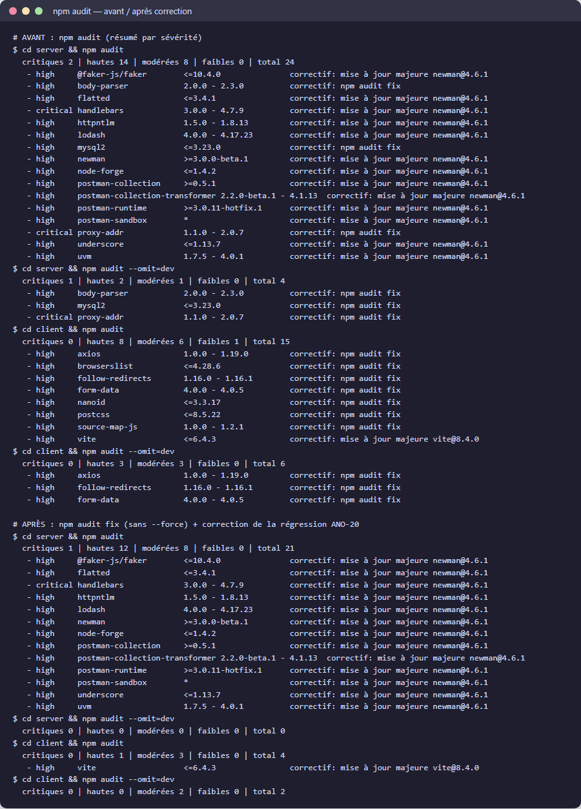
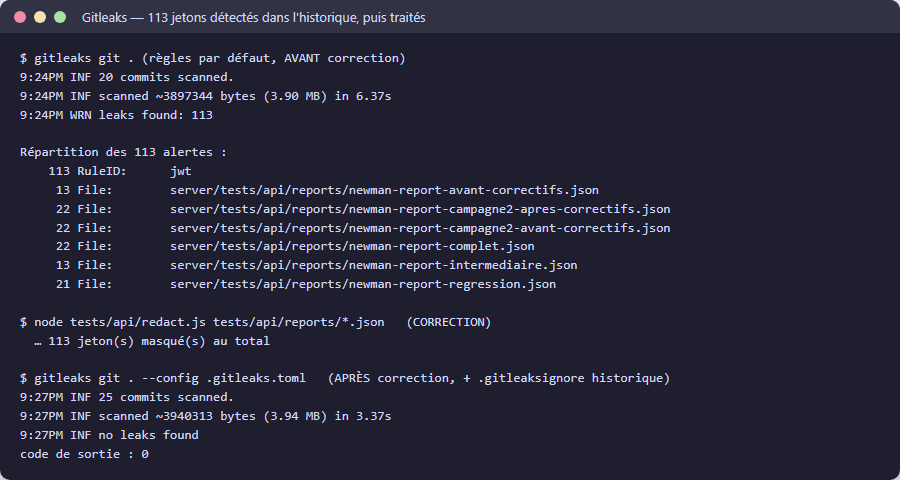
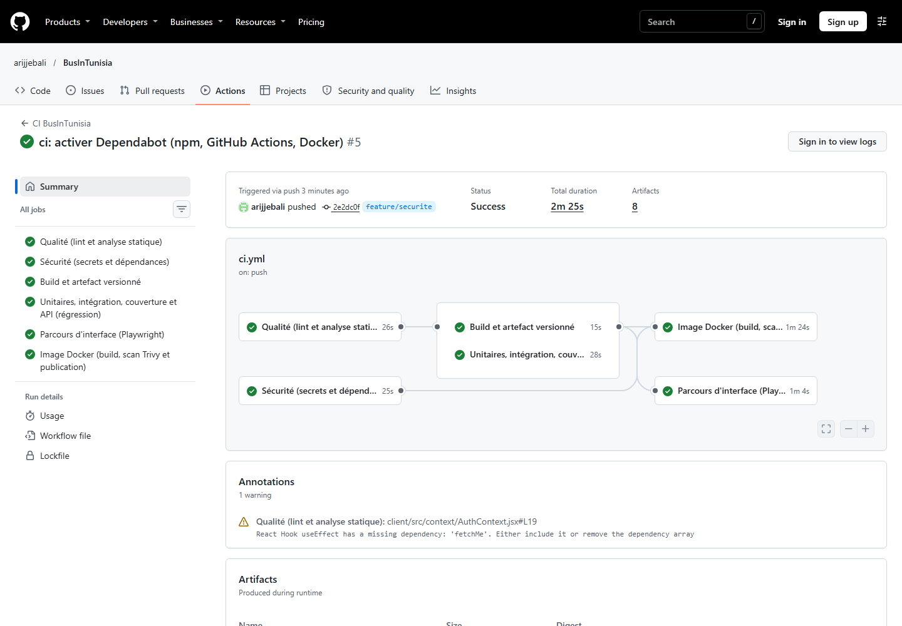

# 6. Contrôles de sécurité DevSecOps (lot 5, partie 2)

## 6.1 Contrôles intégrés à la chaîne

| Contrôle | Outil (version figée) | Où | Ce qui est analysé | Gate (bloquant) |
|---|---|---|---|---|
| Détection de secrets | Gitleaks v8.30.1 (image officielle) | job **security** | **Tout l'historique Git** (`fetch-depth: 0`) | Toute nouvelle fuite |
| Analyse des dépendances | `npm audit` | job **security** | `server/` et `client/` (lockfiles) | Vulnérabilité ≥ *high* dans une dépendance de **production** |
| Scan de l'image | Trivy 0.76.2 (image officielle) | job **docker**, avant publication | Paquets Alpine + paquets npm embarqués | Vulnérabilité *critical* avec correctif disponible |
| Analyse statique de sécurité (SAST) | CodeQL `security-and-quality` | workflow `codeql.yml` | Code JavaScript (injections, XSS…) | Alertes dans *Security → Code scanning* |
| Règles de sécurité du code | ESLint (`no-eval`, `no-new-func`, `react/no-danger`…) | job **quality** | Code serveur et client | Toute erreur |
| Veille des dépendances | Dependabot | `.github/dependabot.yml` | npm, GitHub Actions, image de base Docker | PR hebdomadaires vers `develop` |

**Ordre** : la publication dans ghcr.io (`docker`) dépend de `security` ; une image n'est publiée que si les secrets,
les dépendances **et** l'image elle-même ont passé leurs contrôles. Les rapports bruts sont archivés
(artefacts `rapports-securite` et `rapport-trivy`).

**Choix d'exécution** : Gitleaks et Trivy tournent depuis leurs **images officielles à version figée**, et non par des
actions tierces référencées par un tag mobile. Un tag d'action peut être déplacé vers du code malveillant
(attaque de la chaîne d'approvisionnement, comme l'incident `tj-actions/changed-files` de mars 2025) ; une version
d'image figée et un jeton du pipeline en lecture seule (`permissions: contents: read`) limitent ce risque.

## 6.2 Analyse des dépendances (npm audit) : résultats et corrections

| Périmètre | Avant | Après `npm audit fix` | Action |
|---|---|---|---|
| Serveur, **production** | 1 critique (`proxy-addr`), 2 hautes (`body-parser`, `mysql2`), 1 modérée | **0** | ✅ Corrigé (versions compatibles, sans `--force`) |
| Client, **production** | 3 hautes (`axios`, `follow-redirects`, `form-data`), 3 modérées | **0 haute**, 2 modérées | ✅ Corrigé ; modérées sous le seuil, suivies par Dependabot |
| Serveur, développement | 1 critique + 12 hautes, toutes via `newman` | inchangé | ⚠️ **Accepté, justifié** (ci-dessous) |
| Client, développement | `vite` ≤ 6.4.3 (haute) | inchangé | ⚠️ **Accepté, justifié** (ci-dessous) |

**Justification des alertes non corrigées :**

- **`newman` (outil de tests API)** — la seule « correction » proposée par npm est une rétrogradation vers
  `newman@4.6.1` (version de 2019), plus ancienne que la version actuelle : ce n'est pas un correctif. Newman
  n'est **jamais embarqué** dans l'image (`npm ci --omit=dev`, vérifié par Trivy) et n'exécute que notre propre
  collection, contre une base de test locale. Risque résiduel faible ; à revoir dès qu'une version corrigée paraît
  (Dependabot ouvrira la PR).
- **`vite` (outil de build)** — la vulnérabilité concerne le **serveur de développement** de Vite, qui n'est pas
  utilisé en production : l'image ne contient que les fichiers statiques construits. Le correctif demande une
  migration majeure (Vite 8), planifiée hors du périmètre de ce projet.

**Régression détectée pendant la correction (ANO-20, critique)** : la mise à jour de `mysql2` (3.20 → 3.24) a
changé le format de la colonne JSON `user.roles` ; les administrateurs perdaient leurs droits (403). La suite de
régression l'a détecté **avant le commit** ; `getClientRole` a été corrigé et 7 tests ajoutés. Enseignement : une
mise à jour de sécurité suit le même chemin que tout changement (branche, tests, pipeline, revue).

## 6.3 Détection de secrets (Gitleaks) : 113 alertes analysées

| Constat | Détail |
|---|---|
| Alertes | **113**, toutes de type `jwt`, toutes dans le commit initial `2168b58` |
| Fichiers | Les 6 rapports JSON Newman de `server/tests/api/reports/` |
| Cause | Le rapporteur JSON de Newman enregistre les requêtes et réponses complètes, donc les jetons de connexion (`Authorization: Bearer …`, réponses de `/auth/login`) |
| Gravité réelle | Faible : comptes **fictifs** de la base de test, jetons **expirés** (validité 1 jour, émis le 2026-11-19), signés avec le secret JWT **local** du poste de développement |

Actions :

1. **Cause corrigée** : `server/tests/api/redact.js` masque tout JWT des rapports dès leur production
   (appelé par `runApiTests.js`, 4 tests unitaires).
2. **Fichiers actuels assainis** : 113 jetons remplacés par `[JWT-MASQUÉ]`.
3. **Historique non réécrit**, décision justifiée : réécrire l'historique de branches protégées (force push) casserait
   les clones et les PR existantes, pour des jetons déjà expirés. Les 113 alertes historiques sont listées par
   **empreinte exacte** (commit:fichier:règle:ligne) dans `.gitleaksignore` : toute **nouvelle** fuite reste bloquante.
4. **Rotation recommandée** du `JWT_SECRET` local du poste de développement (`server/.env`), qui a signé ces jetons.
5. **Le contrôle a fonctionné une seconde fois** : pendant la correction, Gitleaks a signalé le jeton factice écrit
   en dur dans le nouveau test unitaire ; le test construit désormais ce jeton à l'exécution. Aucune exception
   n'a été ajoutée pour les fichiers de test (elle pourrait masquer une vraie fuite).

Résultat : `gitleaks git` sur les 25 commits → **no leaks found**, code de sortie 0.

Exceptions de configuration (`.gitleaks.toml`) : modèles `.env.example` / `secrets.env.example` (valeurs vides ou
« changer-moi ») et captures d'écran PNG.

## 6.4 Scan de l'image (Trivy)

Le scan s'exécute sur l'image construite, **avant** sa publication. Rapport JSON complet et tableau HIGH/CRITICAL
archivés dans l'artefact `rapport-trivy` de chaque pipeline. Résultat sur l'image de la branche `feature/securite` :
gate passée (aucune vulnérabilité critique corrigeable), image publiée — voir la capture du pipeline :

Mesures qui réduisent la surface d'attaque de l'image (lot 4) : base `node:22-alpine` minimale, dépendances de
production uniquement, utilisateur non root, aucun secret dans l'image (`.dockerignore`).

## 6.5 Synthèse : alertes traitées

| # | Alerte | Source | Décision |
|---|---|---|---|
| 1 | `proxy-addr` critique, `body-parser`, `mysql2` hautes (production serveur) | npm audit | ✅ Corrigées |
| 2 | `axios`, `follow-redirects`, `form-data` hautes (production client) | npm audit | ✅ Corrigées |
| 3 | 113 JWT dans les rapports de tests | Gitleaks | ✅ Cause corrigée, fichiers assainis, historique documenté |
| 4 | JWT factice en dur dans un test | Gitleaks | ✅ Corrigé avant publication |
| 5 | `JWT_SECRET` en clair dans `ci.yml` | revue (lot 5) | ✅ Secret éphémère généré à chaque exécution |
| 6 | Chaîne `newman` (dev) | npm audit | ⚠️ Acceptée, justifiée § 6.2 |
| 7 | `vite` serveur de dev | npm audit | ⚠️ Acceptée, justifiée § 6.2 |
| 8 | Régression ANO-20 introduite par la correction n° 1 | tests de régression | ✅ Corrigée |
