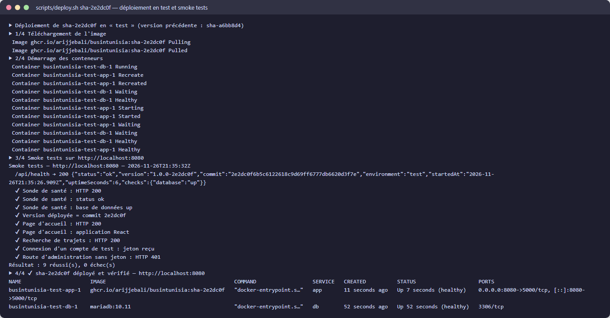
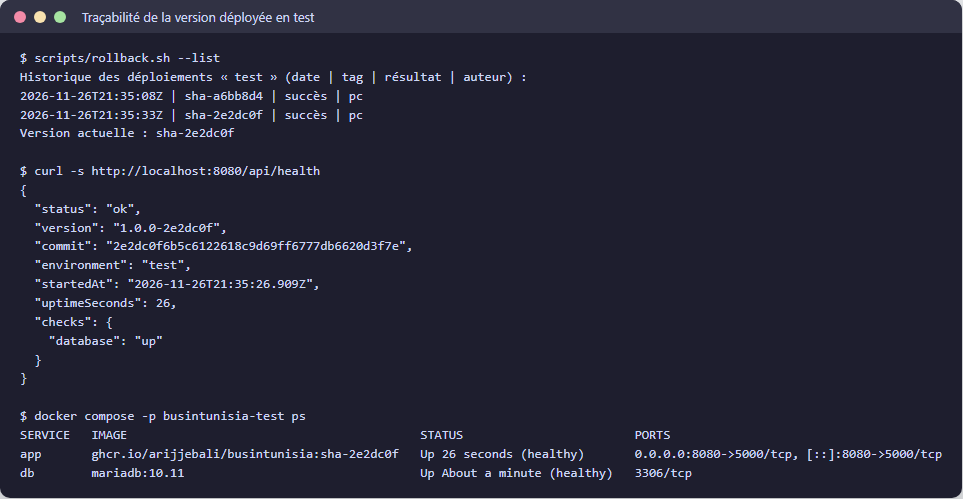
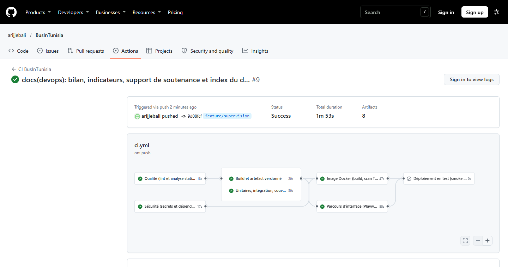

# 7. Déploiement automatisé et vérification (lot 6)

## 7.1 Prérequis à configurer une fois

Ces réglages se font avec le compte propriétaire du dépôt ; ils ne peuvent pas être versionnés.

**1. Runner auto-hébergé (poste de l'environnement de test)**
*Settings → Actions → Runners → New self-hosted runner → Windows x64*, puis dans PowerShell, en suivant les commandes
affichées par GitHub (elles contiennent un jeton d'enregistrement à usage unique) :

```powershell
mkdir C:\actions-runner; cd C:\actions-runner
# … téléchargement et extraction affichés par GitHub …
./config.cmd --url https://github.com/arijjebali/BusInTunisia --token <JETON_AFFICHÉ> --labels busintunisia-test --name poste-test
./run.cmd     # le runner attend les jobs ; laisser la fenêtre ouverte pendant la démonstration
```

Le poste doit avoir Docker Desktop démarré et Git pour Windows (fournit `bash`).

**2. Environnement GitHub « test »**
*Settings → Environments → New environment* `test` :

| Réglage | Valeur | Rôle |
|---|---|---|
| Required reviewers | `arijjebali` | **Approbation manuelle** avant chaque déploiement |
| Deployment branches | *Selected branches* → `develop` | Seule `develop` peut être déployée en test |
| Environment secrets | `TEST_DB_PASSWORD`, `TEST_DB_ROOT_PASSWORD`, `TEST_JWT_SECRET` (≥ 32 caractères) | Secrets de l'environnement (voir [05](05-configuration.md)) |

Pour générer des valeurs : `node -e "console.log(require('crypto').randomBytes(32).toString('base64url'))"`.
⚠️ MariaDB n'applique les mots de passe qu'à la **création** du volume. Si le volume de test existe déjà avec
d'autres mots de passe : `docker compose -p busintunisia-test down -v` avant le premier déploiement par le pipeline.

**3. Sécurité du runner** (dépôt public)
*Settings → Actions → General → Fork pull request workflows* : **Require approval for all external contributors**.
Le job de déploiement ne s'exécute que sur `push` vers `develop` (jamais pour une PR), mais un fork pourrait modifier
le workflow dans sa PR pour viser le runner : l'approbation empêche d'exécuter du code inconnu sur le poste.

## 7.2 Chaîne de déploiement

```
fusion PR → develop ─► CI complète (qualité, sécurité, tests, image scannée et publiée sha-<commit>)
                     ─► job deploy-test : ⏸ attente de l'approbation (environnement « test »)
                     ─► runner du poste de test : scripts/deploy.sh sha-<commit>
                          1. docker compose pull         (image publiée — jamais reconstruite)
                          2. docker compose up --wait     (conteneurs « healthy » sous 120 s)
                          3. scripts/smoke-test.sh        (9 contrôles)
                          4. succès → version enregistrée | échec → rollback automatique + job en échec
```

| Élément | Choix | Justification |
|---|---|---|
| Environnement de test | Poste local, projet Compose `busintunisia-test`, port 8080 | Distinct du développement (projet, port, volume, secrets) ; gratuit ; démontrable en soutenance |
| Ce qui est déployé | L'image **déjà publiée et scannée** `sha-<commit>` | On teste exactement l'artefact qui a passé la CI (« build once, deploy many ») |
| Déclencheur | `push` sur `develop` (donc après fusion d'une PR), CI verte | Rien n'est déployé sans revue ni contrôles |
| Approbation | Required reviewers de l'environnement `test` | Étape sensible validée par un humain |
| Concurrence | `concurrency: deploy-test`, sans annulation | Jamais deux déploiements (ou un déploiement et un rollback) en même temps |
| Secrets | Écrits par le job dans `~/.busintunisia/test-secrets.env` (600) | Jamais dans le dépôt ni dans les journaux |

## 7.3 Smoke tests et sonde de santé

`scripts/smoke-test.sh <url> [commit]` — 9 contrôles, quelques secondes :

| # | Contrôle | Ce qu'il prouve |
|---|---|---|
| 1-3 | `/api/health` → 200, `status: ok`, `database: up` | Application démarrée **et** base joignable |
| 4 | `commit` de `/api/health` = commit déployé | La bonne version est en service (pas une ancienne image en cache) |
| 5-6 | `/` → 200 et contient l'application React | L'interface est servie |
| 7 | Recherche de trajets → 200 | Une requête métier lit la base |
| 8 | Connexion d'un compte de test → jeton | Authentification et secret JWT opérationnels |
| 9 | Route d'administration sans jeton → 401 | Le contrôle d'accès est actif |

Sonde de santé : `GET /api/health` (200 / 503), utilisée par le `HEALTHCHECK` Docker (toutes les 15 s),
`docker compose up --wait`, les smoke tests et la supervision ([08](08-supervision-incident-rollback.md)).

## 7.4 Trace de la version déployée

| Où | Contenu |
|---|---|
| `GET /api/health` | `version` et `commit` de l'image en service |
| `~/.busintunisia/test-deployments.log` | Historique : date, tag, succès/échec/rollback, auteur (`scripts/rollback.sh --list`) |
| `~/.busintunisia/test-current` | Dernier tag déployé avec succès (cible du rollback automatique) |
| GitHub → *Environments → test* | Historique des déploiements du pipeline, lien vers chaque exécution |
| Résumé du job `deploy-test` | Image, URL, version en service, rapport des smoke tests ; artefact `rapport-deploiement-test` |
| Labels de l'image | `org.opencontainers.image.version` / `revision` |

## 7.5 Accès à l'environnement de test

- Application : http://localhost:8080 (comptes de test : `client.test@bus.tn` / `Client123!`, `admin.test@bus.tn` / `Admin123!`)
- Santé : http://localhost:8080/api/health — Indicateurs : http://localhost:8080/api/metrics
- Déploiement manuel d'une version : `bash scripts/deploy.sh sha-<commit>`

## 7.6 Preuves (exécution réelle sur le poste de test)

Déploiement de la version N-1 (`sha-a6bb8d4`) puis de la version N (`sha-2e2dc0f`), images tirées de ghcr.io :





Dans le pipeline, `deploy-test` est **ignoré** sur les branches de fonctionnalité (condition `refs/heads/develop`) ; il s'exécutera après fusion dans `develop`, une fois les prérequis du § 7.1 en place :


