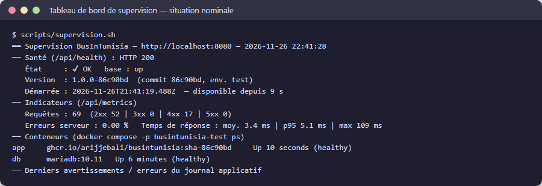
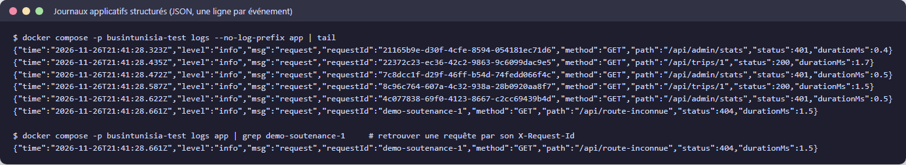
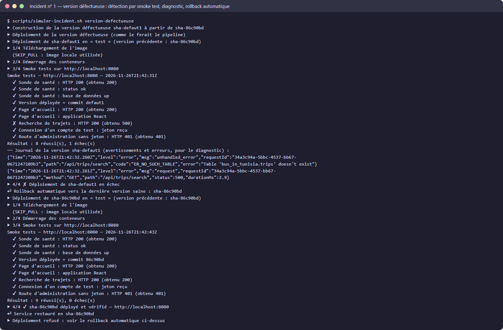
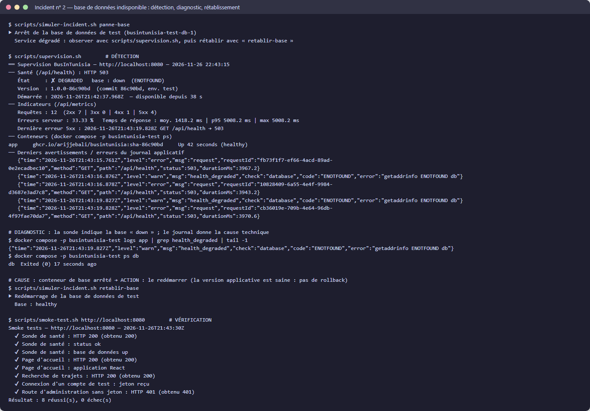
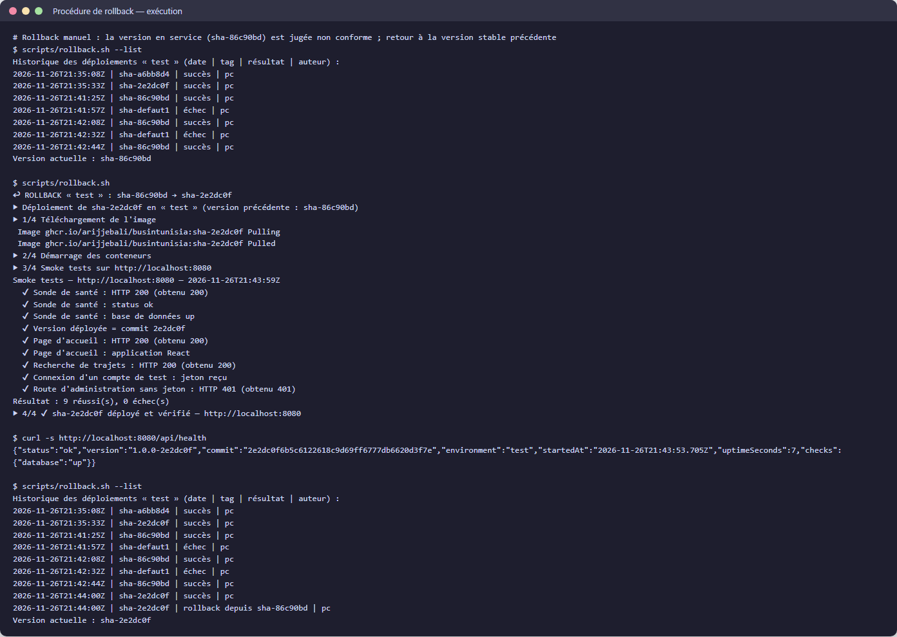

# 8. Supervision, incidents et rollback (lot 7)

## 8.1 Guide de supervision

### Où regarder

| Question | Source | Commande / URL |
|---|---|---|
| Le service répond-il ? La base est-elle joignable ? Quelle version tourne ? | Sonde de santé | `curl http://localhost:8080/api/health` |
| Trafic, erreurs, temps de réponse | Indicateurs techniques | `curl http://localhost:8080/api/metrics` |
| Vue d'ensemble (santé + indicateurs + conteneurs + dernières erreurs) | Tableau de bord terminal | `bash scripts/supervision.sh` (ajouter `http://localhost:8080 --watch` pour un rafraîchissement toutes les 5 s) |
| État des conteneurs | Docker | `docker compose -p busintunisia-test ps` (*healthy* / *unhealthy*) |
| Journal de l'application | Docker (pilote `json-file`, rotation 3 × 10 Mo) | `docker compose -p busintunisia-test logs -f app` |
| Erreurs uniquement | Journal filtré | `docker compose -p busintunisia-test logs app \| grep '"level":"error"'` |
| Une requête précise | Identifiant de requête | `docker compose -p busintunisia-test logs app \| grep <X-Request-Id>` |
| Journal de la base | Docker | `docker compose -p busintunisia-test logs db` |
| Historique des déploiements | Script | `bash scripts/rollback.sh --list` |
| Résultat d'un déploiement par le pipeline | GitHub Actions | Résumé du job `deploy-test`, artefact `rapport-deploiement-test`, *Environments → test* |

### Journal structuré

Une ligne JSON par événement (`server/src/observability.js`), exploitable avec `grep`, `jq` ou un outil
d'agrégation :

```json
{"time":"…","level":"info","msg":"request","requestId":"6f1c…","method":"GET","path":"/api/trips/1","status":200,"durationMs":2.4}
{"time":"…","level":"error","msg":"unhandled_error","requestId":"34a3…","path":"/api/trips/search","code":"ER_NO_SUCH_TABLE","error":"Table 'bus_in_tunisia.trips' doesn't exist"}
{"time":"…","level":"warn","msg":"health_degraded","check":"database","code":"ENOTFOUND","error":"getaddrinfo ENOTFOUND db"}
```

| Niveau | Événements |
|---|---|
| `error` | Réponse 5xx, erreur non gérée (avec code et message de la cause) |
| `warn` | Sonde de santé dégradée (avec la cause technique) |
| `info` | Requêtes, démarrage du serveur (port, version, environnement), création du pool de connexions |
| `debug` | Appels de la sonde de santé (fréquents : masqués en `info`) |

Les paramètres d'URL ne sont pas journalisés (ils peuvent contenir des données personnelles) ; aucun mot de passe ni
jeton n'est écrit. Chaque réponse porte l'en-tête `X-Request-Id`, qui relie l'erreur vue par un utilisateur à sa
ligne de journal.

### Indicateurs techniques (`/api/metrics`)

| Indicateur | Signification | Seuil d'alerte proposé |
|---|---|---|
| `status` de `/api/health` | Disponibilité du service et de la base | ≠ `ok` |
| `uptimeSeconds` | Durée depuis le dernier démarrage (redémarrages inattendus) | remise à zéro non prévue |
| `requests.byStatus` | Volume par famille 2xx / 3xx / 4xx / 5xx | hausse des 5xx |
| `errorRate` | Part de réponses 5xx | > 1 % |
| `responseTimeMs.avg` / `p95` / `max` | Temps de réponse (1 000 dernières requêtes) | p95 > 500 ms |
| `lastServerError` | Date, route et statut de la dernière erreur serveur | — |




## 8.2 Diagnostiquer : méthode

1. **Constater** : `scripts/supervision.sh` (santé, taux d'erreur, dernière erreur) ou échec du job `deploy-test`.
2. **Situer** : quelle version tourne (`/api/health`) ? Que dit l'historique (`rollback.sh --list`) ? Un déploiement
   récent ?
3. **Expliquer** : journal filtré sur `warn`/`error` → champs `code` et `error` ; état des conteneurs (`ps`).
4. **Décider** : défaut de la **version** → rollback ; défaut d'**infrastructure** (base arrêtée, configuration) →
   correction de l'infrastructure, sans rollback.
5. **Vérifier** : `scripts/smoke-test.sh http://localhost:8080`, puis consigner la fiche d'incident.

## 8.3 Fiches d'incident

### INC-01 — Version défectueuse : recherche de trajets en erreur 500

| Champ | Contenu |
|---|---|
| Date | 2026-11-26, environnement de test |
| Déclenchement (simulé) | `scripts/simuler-incident.sh version-defectueuse` : déploiement de `sha-defaut1`, version comportant une faute de frappe SQL (`FROM trips` au lieu de `FROM trip`) dans la recherche de trajets |
| Détection | **Smoke test n° 7** « Recherche de trajets : HTTP 200 (obtenu 500) ». La sonde de santé était **verte** (application et base opérationnelles) : seul un contrôle fonctionnel pouvait détecter ce défaut |
| Diagnostic | Journal conservé par `deploy.sh` avant le rollback : `unhandled_error`, `path: /api/trips/search`, `code: ER_NO_SUCH_TABLE`, `Table 'bus_in_tunisia.trips' doesn't exist`, avec son `requestId` |
| Cause | Défaut de code dans la version livrée (requête SQL) |
| Action | **Rollback automatique** par `deploy.sh` vers la dernière version saine `sha-86c90bd`, puis smoke tests repassés (9/9) |
| Durée d'indisponibilité de la fonction | ≈ 11 s (entre le démarrage de la version défectueuse et la fin du rollback) |
| Impact | Recherche de trajets indisponible pendant le déploiement ; aucune donnée altérée |
| Prévention | La requête de recherche de la collection API (Newman, suite de régression du job backend) aurait bloqué ce défaut en CI : la version défectueuse a été construite **hors pipeline** pour la simulation. La chaîne réelle ne l'aurait pas publiée |



### INC-02 — Base de données indisponible

| Champ | Contenu |
|---|---|
| Déclenchement (simulé) | `scripts/simuler-incident.sh panne-base` : arrêt du conteneur `busintunisia-test-db-1` |
| Détection | `/api/health` → **503** `degraded`, `database: down (ENOTFOUND)` ; `/api/metrics` : taux d'erreurs serveur 33 %, p95 de 5 s |
| Diagnostic | Journal : `health_degraded`, `code: ENOTFOUND`, `getaddrinfo ENOTFOUND db` (le nom DNS du service `db` n'existe plus sur le réseau Docker) ; `docker compose ps -a db` → `Exited` |
| Cause | Conteneur de base arrêté (incident d'infrastructure, pas de la version applicative) |
| Action | **Pas de rollback** : la version est saine. Redémarrage de la base (`retablir-base`), qui revient `healthy` |
| Vérification | Smoke tests 8/8 verts |
| Constats | (1) Docker affichait encore `app (healthy)` : il ne déclare *unhealthy* qu'après 3 échecs consécutifs (≈ 45 s) ; la sonde HTTP réagit immédiatement. (2) La sonde met ≈ 4 s à répondre en l'absence de base (résolution DNS) : un délai maximal explicite sur la vérification est proposé en amélioration |



## 8.4 Procédure de rollback

**Quand** : la version en service est défectueuse (smoke tests en échec, erreurs 5xx après un déploiement, régression
fonctionnelle). **Pas** pour une panne d'infrastructure (voir INC-02).

**Principe** : on ne reconstruit rien ; on redéploie une image **déjà publiée et déjà vérifiée**, identifiée par son
tag immuable `sha-<commit>`, puis on repasse les mêmes smoke tests.

| Mode | Déclenchement | Cible |
|---|---|---|
| **Automatique** | `deploy.sh` quand les conteneurs ne deviennent pas *healthy* ou qu'un smoke test échoue | Dernière version déployée avec succès |
| **Manuel (pipeline)** | *Actions → Rollback (environnement de test) → Run workflow*, champs `version` (facultatif) et `motif` ; approbation de l'environnement `test` | Version saisie, ou dernière version saine précédente |
| **Manuel (poste)** | `bash scripts/rollback.sh` ou `bash scripts/rollback.sh sha-<commit>` | Idem |

Étapes :

1. `bash scripts/rollback.sh --list` : repérer la version en service et la dernière version saine.
2. `bash scripts/rollback.sh [sha-<commit>]` : redéploiement, attente *healthy*, smoke tests.
3. Contrôler : `curl http://localhost:8080/api/health` (champ `commit`) et `scripts/supervision.sh`.
4. Consigner : l'historique note `rollback depuis <version>` ; rédiger la fiche d'incident.
5. Corriger le défaut sur une branche `fix/…` → PR → pipeline → nouveau déploiement.

Limite : le rollback restaure l'**application**, pas les **données**. Une version qui modifierait le schéma de la base
exigerait une migration réversible ou une sauvegarde préalable du volume (hors périmètre ; aucune migration de schéma
dans ce projet).

**Démonstration exécutée** (`sha-86c90bd` → `sha-2e2dc0f`, vérifiée, tracée) :


